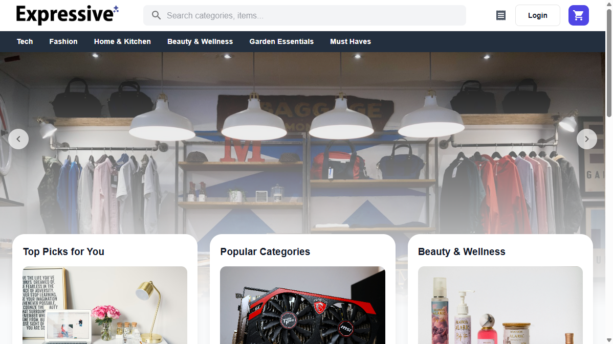
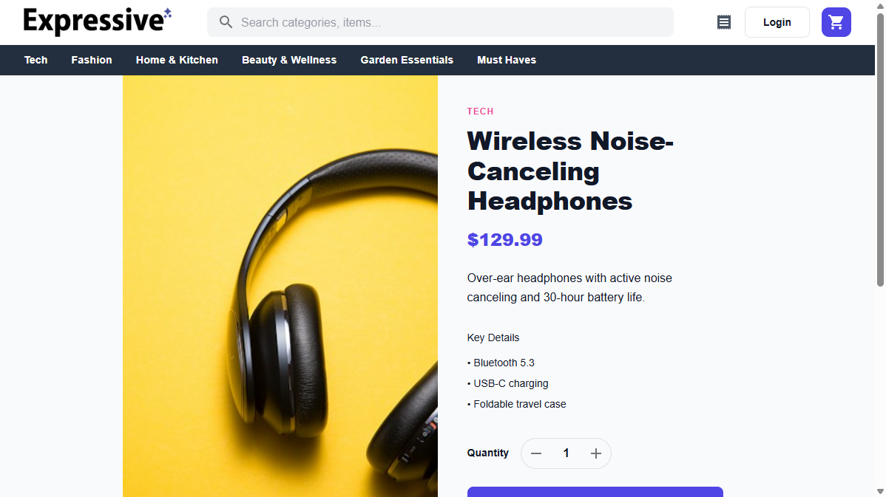
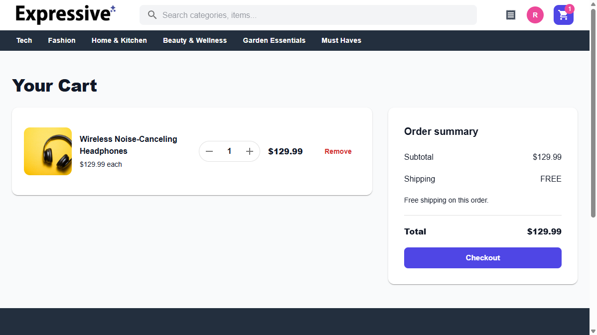
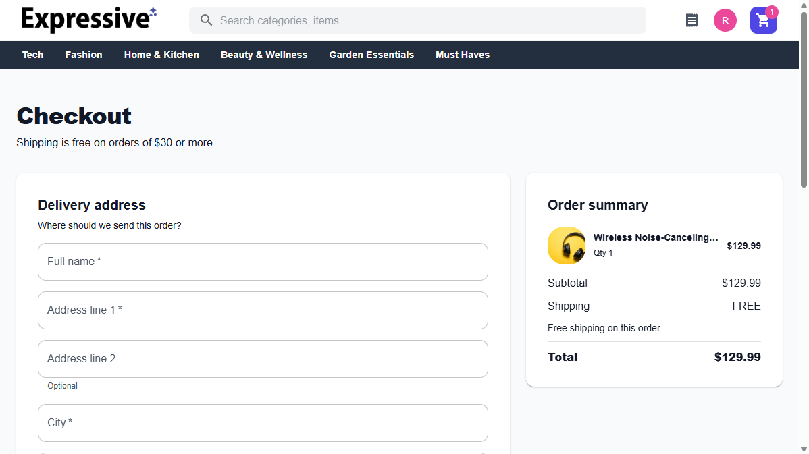

# Expressive Cart

A full-stack shop where someone can create an account, browse a seeded catalog, keep a cart, and pay with a Stripe test card. Successful checkout saves a paid order, stores the card brand and last four digits, and clears the cart.

The storefront is a React app in [`frontend`](./frontend). The API and PostgreSQL schema live in [`backend`](./backend).

- [Frontend README](./frontend/README.md) — routes, client state, and how to run the UI
- [Backend README](./backend/README.md) — API, auth, checkout, and database setup

## What the shop includes

- **Accounts.** Email and password registration and login, optional Google sign-in, a 24-hour session cookie, and logout. Protected pages send guests to login. The account page shows the email and lets the signed-in user update their name.
- **Catalog.** A home page with a promo carousel and category tiles, category browsing, product details (price, description, details, stock), and search across name, description, and category.
- **Cart.** One cart per account, available from the header drawer and the cart page. Guests who add an item are sent to login, and that item is saved into the cart after they sign in. Quantity changes are rejected when they would exceed stock.
- **Checkout.** Delivery address, optional separate billing address, and a Stripe card field. Standard shipping is $5.99, and shipping is free at $30 or more. The charged total is merchandise plus shipping.
- **Orders.** A list and a detail page for the signed-in user, including the order number, status, addresses, and card label. Order details can add a line back to the cart. After at least one order, the home page shows “Buy it again” and recommendations from categories the shopper has already bought.
- **Policies.** Shipping, returns, privacy, and terms pages linked from the footer.

Still out of scope: saved payment methods, favorites, social sharing, an admin catalog, email receipts, and reducing stock when an order is placed.

## Storefront

Home, with category shortcuts over the promo carousel:



A product page, with price, details, and quantity:



The cart, with the shipping quote beside the line items:



Checkout, with the delivery address and the order summary:



## How the pieces fit

```text
Browser (Vite, http://localhost:5173)
  React routes + Redux
  axios /api  --proxy-->  Express (http://localhost:5000/api)
                            Passport session cookie
                            Stripe Charges API
                            PostgreSQL
```

The Vite dev server proxies `/api` to the API so the session cookie stays on the frontend origin. Prices are stored in cents and shown in dollars. Each completed checkout has an order number shaped like `EC` plus eight characters, with status `paid`.

## Run it locally

1. Start PostgreSQL, copy `backend/example.env` to `backend/.env`, then follow the [backend README](./backend/README.md) (`npm install`, `npm run create-db`, `npm run start`). The API listens on port 5000.
2. Follow the [frontend README](./frontend/README.md) (`npm install`, `npm run dev`).
3. Open [http://localhost:5173](http://localhost:5173).

Checkout needs a Stripe test secret key in `backend/.env`. Use Stripe’s test card `4242 4242 4242 4242`, any future expiry, and any CVC.
